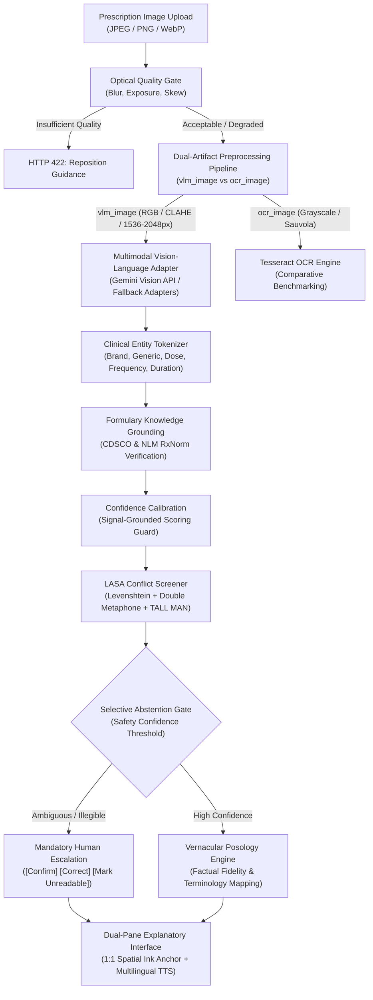

# DawaAI: Explainable Multimodal AI for Handwritten Prescription Understanding
### *Your Prescription, Made Clear.*

[](LICENSE)
[](#development--testing)
[](#technology-stack)
[](#technology-stack)
[](#technology-stack)
[](#technology-stack)
[](#technology-stack)
[](#multilingual-posology)

---

> [!CAUTION]
> ### ⚠️ CLINICAL SAFETY & STATUTORY PHARMACIST-IN-THE-LOOP NOTICE
> **DawaAI is an assistive transcription, evidence-grounding, and posology explanation technology system.**
> - **Statutory Mandate:** Under **Section 42 of the Pharmacy Act (1948)**, dispensing prescription medications without the direct supervision of a Registered Pharmacist is a statutory offence.
> - **Assistive Second-Reader Role:** DawaAI is designed strictly as an assistive reader and posology decoder. **It must NOT be used to dispense, compound, or administer medication without independent qualified pharmacist or clinician verification.**
> - **Authoritative Ground Truth:** The physical handwritten prescription signed by a licensed Registered Medical Practitioner (RMP) remains the sole legally binding medical record.
> - **No Autonomous Medical Advice:** Patients must never initiate, alter, or discontinue prescribed medication regimens without direct consultation with a qualified doctor or licensed pharmacist.

---

## 1. Overview & Problem Statement

Illegible physician handwriting is a persistent hazard in outpatient healthcare delivery. Under severe clinical time constraints, clinicians routinely draft prescriptions using rapid cursive ligatures, non-standard abbreviations (*PC, AC, SOS, TDS, HS*), and irregular pen strokes.

### The Clinical Hazards
- **Adverse Drug Events (ADEs):** Dispensing errors arising from misread dosages or confusable drug names are among the leading preventable clinical errors worldwide.
- **The Generative AI Dilemma:** Conventional OCR engines (e.g., Tesseract) fail catastrophically on cursive scripts (>50% Word Error Rate). Conversely, ungrounded commercial Vision-Language Models (VLMs) suffer from **uncalibrated overconfidence**: when faced with ambiguous strokes (e.g., `1.0 mg` vs `10 mg`), they fabricate plausible-sounding text rather than acknowledging uncertainty.
- **Patient Posology Illiteracy:** Patients frequently struggle to comprehend Latin medical shorthand, leading to non-adherence, incorrect meal intervals, or accidental overdoses.

### The DawaAI Solution
**DawaAI** bridges the gap between raw doctor handwriting and vernacular patient understanding through an **evidence-grounded, uncertainty-calibrated multimodal pipeline**. DawaAI preserves the original physical prescription as the primary ground truth, grounds every candidate medication against statutory pharmacopeias, deliberately abstains when handwriting is ambiguous, and generates clear, actionable dosage schedules in **English**, **Hindi (हिन्दी)**, and **Marathi (मराठी)**.

---

## 2. Core Capabilities

- **1:1 Spatial Ink Grounding:** The original physical prescription image is preserved byte-for-byte. Every extracted entity (medicine name, dosage, frequency, duration, route) links directly to its interactive bounding box on the prescription pad.
- **Continuous Gradient Multimodal Extraction:** Vision-language adapter architecture leveraging high-resolution visual tokens to transcribe cursive ligatures without destructive binary clipping.
- **Formulary Knowledge Grounding (RAG):** Candidate medications are strictly validated against authoritative reference databases:
  - **CDSCO (India):** Directorate General of Health Services approved drug formulations.
  - **NLM RxNorm (US NLM):** Normalized clinical medicine nomenclature and RxCUIs.
  - *Safety Invariant:* Non-existent medicines are rejected; observed dosages are strictly immutable and never rewritten.
- **Uncertainty-Aware Selective Abstention:** The system measures predictive entropy and calibration signals. If handwriting is illegible, smudged, or conflicting, the pipeline **deliberately abstains** and flags the script for human pharmacist verification rather than guessing.
- **Look-Alike / Sound-Alike (LASA) Conflict Guard:** Computes orthographic (Levenshtein) and phonetic (Double Metaphone) similarity against the ISMP confusable drug catalogue. Applies standardized **TALL MAN lettering** (e.g., `metFORMIN` vs `metRONIDAZOLE`) to prevent dispensing errors.
- **Multilingual Patient Posology:** Converts complex clinical shorthand into clear posology schedules with morning/afternoon/night slots, meal relations, precautions, and browser-native voice narration in **English**, **Hindi (हिन्दी)**, and **Marathi (मराठी)**.
- **Human-in-the-Loop Clinical Verification:** Interactive clinician review workflow with three unambiguous actions: `[Confirm]`, `[Correct]`, and `[Mark Unreadable]` with complete audit logging.

---

## 3. System Architecture



### Dual-Artifact Preprocessing Strategy (VLM vs. OCR)

Conventional document binarization algorithms (e.g. Otsu or Sauvola thresholding) clip pixel intensities to strict black or white values (`{0, 255}`). While helpful for legacy optical character recognition engines (like Tesseract), aggressive thresholding is **destructive for cursive medical handwriting**: it shears delicate cursive ligatures, obliterates faint ballpoint ink strokes, and erases critical decimal points (e.g., falsely mutating `0.5 mg` to `5 mg`).

To overcome this, DawaAI implements a **Dual-Artifact Preprocessing Strategy**:

1. **VLM-Optimized Artifact (`vlm_image`):**
   - **Continuous Gradient & Color Preservation:** Retains full 24-bit RGB space. Ballpoint pen pressure variations, colored ink distinctions (blue/black clinician ink vs. red headers or stamps), and subtle decimal dots are preserved without binary clipping.
   - **EXIF Transposition:** Automatically resolves camera sensor orientation metadata (`ImageOps.exif_transpose`) so smartphone prescription snapshots are correctly oriented upright prior to inference.
   - **Resolution Preservation Window:** Source images with longest edges between **1536px and 2048px** are strictly preserved at native resolution. Oversized images (>2048px) are downscaled using high-fidelity Lanczos resampling to prevent payload size errors, while smaller images are never artificially downsampled.
   - **Non-Destructive Contrast Tuning:** Applies percentile contrast stretching in luminance space to optimize stroke contrast against tinted clinic pads without obliterating ink nuances.

2. **OCR-Optimized Artifact (`ocr_image`):**
   - Generates single-channel 8-bit luminance representations, spatial illumination correction (Gaussian background division), median stroke denoising, discrete projection-profile deskewing, and local adaptive Sauvola binarization specifically tailored for Tesseract character-boundary tokenization.

3. **Asynchronous Non-Blocking Execution:**
   - Synchronous network I/O and CPU-bound OpenCV/NumPy/SciPy image processing are wrapped in `asyncio.to_thread(...)`, guaranteeing that the FastAPI ASGI event loop remains completely unblocked during OCR or preprocessing runs.

---

### Epistemic Status Tracking & Selective Abstention

To eliminate generative hallucinations and dangerous overconfident assumptions, DawaAI enforces strict per-field epistemic status tracking:

| Epistemic Status | Definition & Clinical Trigger | Downstream Policy & Abstention Action |
| :--- | :--- | :--- |
| `EXTRACTED` | Legible handwriting tokens grounded in visual ink evidence and verified against formulary/posology norms. | Processed into structured posology schedule if calibrated confidence meets threshold. |
| `MISSING_ON_RX` | Field was omitted by the prescriber on the slip (e.g. duration or frequency left unspecified). | Rendered with explicit fallback disclaimers; strictly forbidden from being fabricated. |
| `ILLEGIBLE` | Ink strokes are present on the slip, but characters cannot be resolved reliably (e.g., severe stroke collapse, smudge, or `[?]`). | Mandatory abstention (`requires_pharmacist_verification = True`). Posology blocked for unverified medicine names. |
| `AMBIGUOUS` | Multiple plausible competing interpretations, candidate overlap without distinct separation, or active Look-Alike / Sound-Alike collision. | Mandatory abstention (`requires_pharmacist_verification = True`). Requires clinician review. |
| `UNVERIFIED` | Legible medication candidate text that cannot be verified or matched against authoritative CDSCO or NLM RxNorm reference formularies. | Mandatory abstention (`requires_pharmacist_verification = True`). Never promoted as clinical fact. |

---

## 4. Technology Stack

| Layer | Technologies | Role & Architectural Rationale |
| :--- | :--- | :--- |
| **Frontend Framework** | **React 19** + **TypeScript** (Strict) | High-performance, concurrent component architecture with compile-time type safety. |
| **Bundler & Build** | **Vite 8** + `@tailwindcss/vite` | Sub-second Hot Module Replacement (HMR) and optimized, code-split production bundles. |
| **Styling & Design** | **Tailwind CSS v4** + Brand Kit | Clean healthcare aesthetic: Plum (`#4A2E4D`), Rose (`#F472B6`), Soft Pink (`#FFD6DA`), Canvas (`#F8F2F6`). |
| **Visual Effects** | Custom HTML5 Canvas | Interactive 3D Silk Gradient Ribbon hero animation with pointer responsiveness. |
| **Backend API** | **FastAPI** + **Python 3.12** + **Uvicorn** | High-throughput asynchronous ASGI microservice with automatic OpenAPI schema generation. |
| **Data Contracts** | **Pydantic v2** | Strict bidirectional request/response validation with immutable audit schemas. |
| **Image Processing** | **Pillow** + **NumPy** + **SciPy** | Deterministic optical validation: Laplacian blur, projection-profile deskewing, Sauvola binarization. |
| **AI / Multimodal** | **Google Gemini API** (`gemini-3.5-flash-lite`) | Multimodal vision-language understanding of cursive handwriting ligatures. |
| **Reference Grounding** | **CDSCO** & **NLM RxNorm** Data Stores | Authoritative formulary verification and formulation consistency screening. |
| **Phonetic Engine** | **Double Metaphone** + **Levenshtein** | ISMP TALL MAN confusable drug name collision detection. |
| **Speech Synthesis** | Web Speech API | Client-side vernacular text-to-speech for accessible dosage schedules. |

---

## 5. Repository Structure

```text
genai-prescription-decoder/
├── index.html                   # HTML entry with DM Serif Display & Inter typography
├── package.json                 # Frontend dependencies & build scripts
├── tsconfig.json                # Strict TypeScript configuration
├── vite.config.ts               # Vite configuration with @ path aliases
├── backend/                     # FastAPI backend application
│   ├── app/
│   │   ├── main.py              # FastAPI app factory, CORS, exception handlers
│   │   ├── config.py            # Pydantic v2 settings & environment configuration
│   │   ├── api/v1/routes/       # /process, /analyze, /health, /multimodal, /validation, etc.
│   │   ├── models/              # Pydantic data schemas, enums, and error models
│   │   ├── services/            # Multimodal pipeline, mock pipeline, and file storage
│   │   ├── preprocessing/       # Optical quality validator, deskew, and Sauvola pipeline
│   │   ├── ocr/                 # Tesseract OCR baseline comparison engine
│   │   └── multimodal/          # Gemini vision adapters, parser, and prompt schemas
│   ├── tests/                   # Pytest test suite (unit and integration tests)
│   ├── requirements.txt         # Backend Python dependencies
│   └── run.py                   # Local development server runner (dynamic port binding)
├── ai/                          # Clinical safety & intelligence engines
│   ├── rag/                     # CDSCO & RxNorm formulary grounding engine
│   ├── confidence/              # Calibration metrics and scoring models
│   ├── abstention/              # Uncertainty-aware selective abstention policies
│   ├── lasa/                    # Look-Alike / Sound-Alike collision detector
│   └── explanation/             # Multilingual posology engine (EN, HI, MR)
├── data/                        # Sample data, ground-truth manifests, and reference sets
│   ├── manifests/               # Cryptographic SHA-256 dataset manifests
│   ├── reference/               # Curated CDSCO & RxNorm reference datasets
│   └── samples/                 # Standard calibration and CI prescription samples
├── docs/                        # Complete project documentation & reports
│   ├── BASELINE_RESULTS.md      # Detailed clinical evaluation benchmark report
│   ├── DAWAAI_FINAL_CLOSURE_VERIFY.md # Verification bundle and audit export
│   ├── FINAL_RELEASE_REPORT.md  # Acceptance and release audit report
│   ├── PRODUCTION_READINESS_CHECKLIST.md # Security, zero-retention PHI, and readiness checklist
│   ├── capstone-final-report.md # Comprehensive 14-Phase Capstone Thesis Report
│   ├── research-paper-draft.md  # Academic paper draft (IEEE/ACM style)
│   ├── architecture-dfd.md      # System Data Flow Diagrams (Level 0, 1, 2)
│   ├── DEPLOYMENT_RUNBOOK.md    # Production deployment runbook
│   ├── SECURITY_AND_PRIVACY.md  # Ephemeral storage and zero-PHI policy
│   └── API.md                   # Complete OpenAPI specification
├── eval/                        # Evaluation scripts, tables, and plots
├── src/                         # React 19 frontend source code
│   ├── main.tsx                 # Application DOM mount
│   ├── App.tsx                  # Root application router and layout shell
│   ├── styles/globals.css       # Tailwind CSS design system tokens and glass panels
│   ├── components/              # UI components (Hero, Navbar, Workspace, Safety, Posology)
│   ├── services/api/            # HTTP and mock prescription API client adapters
│   └── types/                   # TypeScript interfaces for API, safety, and posology
└── Dockerfile                   # Production container definition
```

---

## 6. Getting Started & Local Setup

### Prerequisites
- **Node.js**: `v20.x` or later (tested on v20, v22, v24)
- **Python**: `3.11` or later (tested on Python 3.12)
- **Google Gemini API Key**: Obtainable from [Google AI Studio](https://aistudio.google.com/)

---

### Step 1: Clone & Configure Environment

```bash
git clone https://github.com/SwayamMandhani06/genai-prescription-decoder.git
cd genai-prescription-decoder

# Copy the example environment file
cp .env.example .env
```

Configure your `.env` file:
```ini
# Google Gemini API Key for live cursive handwriting understanding
GEMINI_API_KEY=your_gemini_api_key_here

# Multimodal model selection
MULTIMODAL_MODEL_ID=gemini-3.5-flash-lite

# Pipeline mode (set to live for real multimodal model inference)
INFERENCE_MODE=live
USE_MOCK_PIPELINE=false

# Port configuration
PORT=8001
VITE_API_BASE_URL=http://localhost:8001
```

---

### Step 2: Backend Setup (FastAPI)

```bash
# Recommended: Create and activate a Python virtual environment
python -m venv venv

# On Windows:
.\venv\Scripts\activate
# On Linux/macOS:
# source venv/bin/activate

# Install dependencies
pip install -r backend/requirements.txt

# Start the FastAPI backend server
python backend/run.py
```
*The backend starts at `http://localhost:8001` (interactive Swagger API docs available at `http://localhost:8001/docs`).*

---

### Step 3: Frontend Setup (React + Vite)

In a new terminal window:
```bash
# Install Node dependencies
npm install

# Start the Vite development server
npm run dev
```
*The frontend application will be live at `http://localhost:5173`.*

---

### Alternative: Docker Compose

```bash
docker compose up --build
```
*Access the unified application at `http://localhost:8000`.*

---

## 7. API Reference

| Endpoint | Method | Description |
| :--- | :---: | :--- |
| `/api/v1/prescriptions/process` | `POST` | Primary prescription processing endpoint (accepts `multipart/form-data` image or sample ID). |
| `/api/v1/prescriptions/analyze` | `POST` | Preserved endpoint alias for backwards compatibility. |
| `/health` | `GET` | Root load-balancer health probe with runtime dependency status. |
| `/api/v1/health` | `GET` | Versioned API health and active pipeline diagnostic report. |
| `/api/v1/verification/{id}/fields/{f}/confirm` | `POST` | Clinician confirmation of an extracted field in the audit trail. |
| `/api/v1/verification/{id}/fields/{f}/correct` | `POST` | Clinician correction of an extracted field (preserves original extraction). |
| `/api/v1/verification/{id}/fields/{f}/unreadable` | `POST` | Explicit unreadable stroke marking without guessing. |
| `/api/v1/multimodal/extract` | `POST` | Dedicated vision-language extraction endpoint. |
| `/api/v1/validation/medicine` | `POST` | RAG CDSCO and RxNorm formulary grounding verification. |
| `/api/v1/lasa/detect` | `POST` | Orthographic and phonetic Look-Alike / Sound-Alike screening. |
| `/api/v1/explanation/generate` | `POST` | Multilingual patient posology generation (`en`, `hi`, `mr`). |

---

## 8. Development & Testing

```bash
# 1. Run backend automated test suite
python -m pytest backend/tests -v

# 2. Run frontend automated verification suite (14 UI states)
npm test

# 3. Static TypeScript compilation check
npm run lint

# 4. Production bundle build check
npm run build

# 5. Run reproducible live benchmark evaluation runner
python -m backend.app.dataset.evaluator --mode live
```

> [!NOTE]
> Detailed clinical evaluation reports, metric explanations, and per-document diagnostics are documented in [`docs/BASELINE_RESULTS.md`](docs/BASELINE_RESULTS.md) and [`docs/FINAL_RELEASE_REPORT.md`](docs/FINAL_RELEASE_REPORT.md).

---

## 9. Production Deployment Guide

### Frontend Deployment (Vercel)
1. Import the repository on [Vercel](https://vercel.com).
2. Set the **Framework Preset** to **Vite**.
3. Configure the following **Environment Variables** in the Vercel dashboard:
   - `VITE_API_BASE_URL`: The URL of your deployed backend (e.g., `https://api.yourdomain.com`).
   - `VITE_USE_MOCK_API`: `false`
4. Deploy. Vercel automatically runs `npm run build` and serves the optimized single-page app via edge CDN.

### Backend Deployment (Render / Cloud Container)
1. Create a new **Web Service** on your cloud platform connected to this repository.
2. Select **Docker** environment (or **Python 3** with `pip install -r backend/requirements.txt`).
3. Set the **Start Command**:
   ```bash
   uvicorn backend.app.main:app --host 0.0.0.0 --port $PORT
   ```
4. Configure the following **Environment Variables**:
   - `ENV`: Set to `production`.
   - `INFERENCE_MODE`: Set to `live`.
   - `GEMINI_API_KEY`: Your Google AI Studio API key.
   - `CORS_ORIGINS`: Your production frontend domain.

#### Production Configuration Variables

| Variable | Values | Default | Description |
| :--- | :--- | :--- | :--- |
| `ENV` / `ENVIRONMENT` | `development`, `test`, `production` | `development` | Operating environment. In `production`, mock mode execution is strictly prohibited. |
| `INFERENCE_MODE` | `live`, `mock` | `live` | Pipeline mode. In `live` mode, provider errors raise structured `UpstreamInferenceError`. |
| `GEMINI_API_KEY` | string | *None* | Google AI Studio API key. Mandated when in `live` mode. |
| `RETENTION_TTL_SECONDS` | integer | `0` | Ephemeral PHI retention window in seconds. `0` enforces strict zero-retention (immediate unlinking in `finally:` block). |
| `MAX_UPLOAD_SIZE_BYTES` | integer | `10485760` | Strict file upload size cap (10 MB). Read in 64 KB chunks with early HTTP 413 abort. |
| `CORS_ORIGINS` | string / list | *Allowed List* | Comma-separated list of permitted web origins. Wildcards (`*`) are strictly forbidden in production. |
| `REQUIRE_API_KEY` | `false`, `true` | `false` | When enabled, mandates `X-API-Key` or `Bearer` authentication on protected endpoints. |
| `RATE_LIMIT_PER_MINUTE` | integer | `60` | Sliding-window request limit per client IP (returns HTTP 429 with `Retry-After`). |

---

## 10. Security & Ephemeral Zero-Retention PHI Policy

DawaAI adheres strictly to the Digital Personal Data Protection (DPDP) Act (India), HIPAA Security Rule, and GDPR requirements for processing sensitive medical records:

1. **Zero-Retention Ephemeral Storage:**
   - When `RETENTION_TTL_SECONDS=0` (default in production), uploaded prescription files and derived preprocessing artifacts in `backend/uploads/` and `data/processed/` are unconditionally purged inside a `finally:` block upon request termination.
   - Zero patient images persist on unencrypted disk volumes after response completion.
2. **Path Traversal Immunity:**
   - File storage generates random UUIDv4 filenames (`rx_<uuid4>.png`), completely isolating filesystem storage from user-supplied filenames. Directory traversal sequences (`..`, `/`, `\`) at ingress return HTTP 400.
3. **Ingress Protection & Magic Byte Verification:**
   - Upload streams are consumed in 64 KB chunks to prevent RAM exhaustion, aborting immediately with HTTP 413 if the payload exceeds 10 MB. Binary magic bytes (`PNG`, `JPEG`, `WebP`, `TIFF`, `BMP`) are validated to prevent extension spoofing.
4. **Anti-Caching & Security Headers:**
   - All prescription routes enforce `Cache-Control: no-store, no-cache, must-revalidate, private` and `Pragma: no-cache` to prevent proxy or shared-terminal browser caching. Standard headers include `X-Content-Type-Options: nosniff`, `X-Frame-Options: DENY`, and `Strict-Transport-Security`.
5. **PHI-Safe Observability:**
   - The application logging pipeline incorporates automated sanitization filters that redact API keys, tokens, Base64 image payloads, patient names, and raw cursive transcriptions from production logs.
6. **Container Least-Privilege & Deep Health Probes:**
   - The production container executes as an unprivileged non-root user (`appuser`, UID 10001). Container health probes actively verify formulary dataset availability, upload directory writability, and configuration integrity.

---

## 11. Project Documentation Index

All detailed engineering, research, and audit documentation is consolidated in the [`docs/`](docs/) directory:

| Document | Purpose & Scope |
| :--- | :--- |
| **[Baseline Clinical Evaluation Report](docs/BASELINE_RESULTS.md)** | Full 11-metric clinical benchmark report over physical prescription samples. |
| **[Final Verification & Audit Closure Export](docs/DAWAAI_FINAL_CLOSURE_VERIFY.md)** | Line-by-line verification evidence and implementation audit trail. |
| **[Final Release Report](docs/FINAL_RELEASE_REPORT.md)** | End-to-end acceptance, test verification, and production release determination. |
| **[Production Readiness Checklist](docs/PRODUCTION_READINESS_CHECKLIST.md)** | Security controls, zero-retention PHI policy, and container audit. |
| **[Capstone Final Report](docs/capstone-final-report.md)** | Comprehensive thesis covering mathematical foundations, error taxonomy, and evaluation. |
| **[Research Paper Draft](docs/research-paper-draft.md)** | Academic manuscript prepared with IEEE/ACM styling. |
| **[Architecture & Data Flow Diagrams](docs/architecture-dfd.md)** | Level 0, Level 1, and Level 2 Data Flow Diagrams. |
| **[Deployment Runbook](docs/DEPLOYMENT_RUNBOOK.md)** | Step-by-step production operations, scaling, and incident response guide. |
| **[Security & Privacy Policy](docs/SECURITY_AND_PRIVACY.md)** | Ephemeral memory storage, zero-PHI persistence, and DevSecOps controls. |
| **[REST API Specification](docs/API.md)** | Complete OpenAPI documentation with error contracts. |

---

## 12. License & Authors

Distributed under the **MIT Academic License**. See [`LICENSE`](LICENSE) for terms.

- **Author:** Swayam Mandhani
- **Project Identity:** DawaAI (*Your Prescription, Made Clear.*)
- **Domains:** Multimodal Medical Vision-Language Models, Clinical NLP, Uncertainty Quantification, Vernacular Health Equity.
