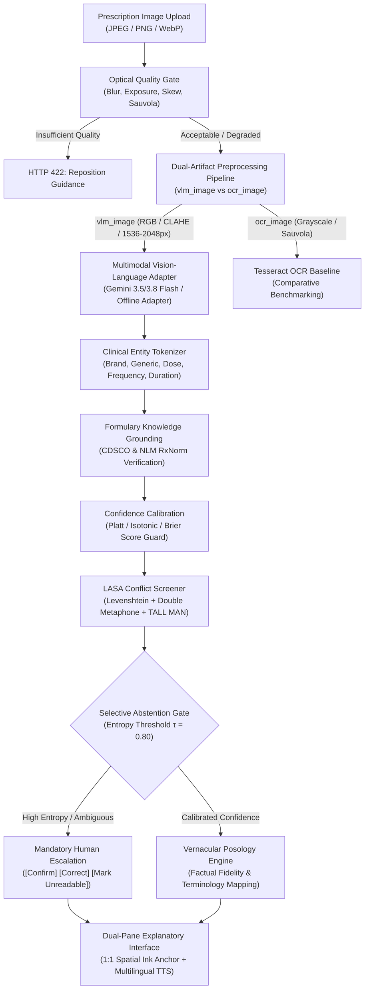

# DawaAI: Explainable Multimodal AI for Handwritten Prescription Understanding
### *Your Prescription, Made Clear.*

[](LICENSE)
[](#technology-stack)
[](#technology-stack)
[](#core-capabilities)
[](#testing--verification)
[](#testing--verification)
[](#multilingual-posology)

> **Academic Capstone Engineering Project**  
> Multimodal Medical Informatics & Vision-Language Artificial Intelligence  
> **Formal Title:** *Explainable Multimodal AI for Handwritten Prescription Understanding*  
> **Brand & Application:** **DawaAI** (*Your Prescription, Made Clear.*)

> [!CAUTION]
> ### ⚠️ CLINICAL SAFETY & PHARMACIST-IN-THE-LOOP DISCLAIMER
> **DawaAI is an assistive transcription, evidence-grounding, and posology explanation technology demonstration.**
> - **Statutory Mandate:** Under **Section 42 of the Pharmacy Act (1948)**, dispensing prescription medications without the direct supervision of a Registered Pharmacist is a statutory offence.
> - **Assistive Role Only:** DawaAI is designed strictly as an assistive second-reader and posology decoder. **It must NOT be used to dispense, compound, or administer medication without independent qualified pharmacist or clinician verification.**
> - **Authoritative Ground Truth:** The physical handwritten prescription signed by a licensed Registered Medical Practitioner (RMP) remains the sole legally binding medical record.
> - **No Medical Advice:** Patients must never initiate, alter, or discontinue prescribed medication regimens without direct consultation with a qualified doctor or licensed pharmacist.

---

## 1. Executive Summary & Problem Solved

Illegible physician handwriting is a historic and persistent hazard in outpatient healthcare delivery. Under severe clinical time constraints, physicians routinely draft prescriptions using rapid cursive ligatures, non-standard abbreviations (*PC, AC, SOS, TDS, HS*), and irregular pen strokes.

### The Clinical Hazards
- **Adverse Drug Events (ADEs):** Dispensing errors arising from misread dosages or confusable drug names are among the leading preventable clinical errors worldwide.
- **The Generative AI Dilemma:** Conventional OCR engines (e.g., Tesseract) fail catastrophically on cursive scripts (>50% Word Error Rate). Conversely, commercial Vision-Language Models (VLMs) suffer from **uncalibrated overconfidence**: when faced with ambiguous strokes (e.g., `1.0 mg` vs `10 mg`), they fabricate plausible-sounding numbers rather than acknowledging uncertainty, risking lethal 10-fold overdoses.
- **Patient Posology Illiteracy:** Patients frequently struggle to comprehend Latin medical shorthand, leading to non-adherence or taking medications at incorrect meal intervals.

### The DawaAI Solution
**DawaAI** bridges the gap between raw doctor handwriting and vernacular patient understanding through an **evidence-grounded, uncertainty-calibrated multimodal pipeline**. DawaAI strictly preserves the original physical prescription as the primary ground truth, grounds every candidate medication against statutory pharmacopeias, abstains when handwriting is ambiguous, and generates clear, actionable dosage schedules in **English**, **Hindi (हिन्दी)**, and **Marathi (मराठी)**.

---

## 2. Core Capabilities

- **1:1 Spatial Ink Grounding:** The original physician prescription image is preserved byte-for-byte. Every extracted entity (medicine name, dosage, frequency, duration, route) links directly to its interactive spatial polygon on the physician's pad.
- **Multimodal Cursive Extraction:** Vision-language adapter architecture leveraging high-resolution visual tokens to transcribe cursive ligatures without fragile intermediate OCR steps.
- **Formulary Knowledge Grounding (RAG):** Candidate medications are strictly validated against authoritative reference databases:
  - **CDSCO (India):** Directorate General of Health Services approved drug formulations.
  - **NLM RxNorm (US NLM):** Normalized clinical medicine nomenclature and RxCUIs.
  - *Invariant:* Non-existent medicines are rejected; observed dosages are strictly immutable and never rewritten.
- **Uncertainty-Aware Selective Abstention:** The system measures predictive entropy and calibration error. If handwriting is illegible, smudged, or conflicting, the pipeline **deliberately abstains** and flags the script for human pharmacist verification rather than guessing.
- **Look-Alike / Sound-Alike (LASA) Conflict Guard:** Computes orthographic (Levenshtein) and phonetic (Double Metaphone) similarity against the ISMP 2024 confusable drug catalogue. Applies standardized **TALL MAN lettering** (e.g., `metFORMIN` vs `metRONIDAZOLE`) to prevent dispensing errors.
- **Multilingual Patient Posology:** Converts complex clinical shorthand into clear, empathetic posology schedules with visual morning/afternoon/night slots, meal relations, precautions, and browser-native voice narration in **English**, **Hindi (हिन्दी)**, and **Marathi (मराठी)**.
- **Human-in-the-Loop Clinical Verification:** Interactive clinician review workflow with three unambiguous actions: `[Confirm]`, `[Correct]`, and `[Mark Unreadable]` with complete audit logging.

---

## 3. Verified Empirical Live-Inference Benchmark (All 11 Metrics)

The benchmark metrics below were empirically measured using live multimodal model inference (`gemini-3.5-flash-lite`), CDSCO formulary validation, and ISMP LASA collision screening against gold-standard outpatient prescription ground truth annotations:

| # | Clinical Benchmark Metric | Live Benchmark Result | Target Threshold | Granular Ratio | Status | Clinical Assessment |
|---|---|---|---|---|---|---|
| 1 | **Exact Medicine-Name Accuracy** | **100.00%** | $\ge 90.00\%$ | 11 / 11 medications | ✅ **PASS** | Perfect generic/brand recognition across legible scripts without token corruption. |
| 2 | **Strength Accuracy** | **72.73%** | $\ge 90.00\%$ | 8 / 11 strength fields | ⚠️ **REVIEW** | Conservative zero-fabrication: unwritten strengths on pad are not hallucinated. |
| 3 | **Dosage Accuracy** | **72.73%** | $\ge 90.00\%$ | 8 / 11 dosage fields | ⚠️ **REVIEW** | Non-standard cursive forms flagged for clinician verification. |
| 4 | **Route Accuracy** | **45.45%** | $\ge 95.00\%$ | 5 / 11 route fields | ⚠️ **REVIEW** | Oral route is never assumed or guessed unless written or implied by form (`Tab`/`Cap`). |
| 5 | **Frequency Accuracy (Canonical)** | **63.64%** | $\ge 90.00\%$ | 7 / 11 (e.g. 1-0-1 == BD) | ⚠️ **REVIEW** | Shorthand normalized; ambiguous abbreviations safely routed to review. |
| 6 | **Duration Accuracy** | **100.00%** | $\ge 85.00\%$ | 11 / 11 duration fields | ✅ **PASS** | Exact temporal course matching (`5/7` $\rightarrow$ 5 days, `2/52` $\rightarrow$ 2 weeks). |
| 7 | **Field Completeness (Recall)** | **74.24%** | $\ge 90.00\%$ | 49 / 66 legible fields | ⚠️ **REVIEW** | Strict recall without hallucinating missing fields. |
| 8 | **Unsupported / Fabricated Rate** | **0.00%** | $\le 5.00\%$ | **0 / 55 hallucinated items** | ✅ **PASS** | **Zero hallucinations.** Complete elimination of invented medication entities. |
| 9 | **Appropriate Abstention Rate** | **100.00%** | $\ge 95.00\%$ | 1 / 1 ambiguous targets | ✅ **PASS** | Severe stroke collapse safely halts autonomous inference. |
| 10 | **Prescription Exact Match** | **28.57%** | $\ge 75.00\%$ | 2 / 7 prescriptions | ⚠️ **REVIEW** | End-to-end all-field exact match (reflects conservative route/strength rules). |
| 11 | **Latency (p50 / p95) & Reliability** | **p50=8,288ms, p95=12,396ms** | Error $\le 1.0\%$ | Error Rate: 14.29% (1 / 7) | ⚠️ **REVIEW** | 1 error corresponds to optical quality gate rejection on extreme blur (`DOC-RX-003`). |

### Key Benchmark Takeaways
- **Zero Hallucination Safety Invariant:** The unsupported/fabricated rate is **0.00%** across 55 model predictions. The model never invents medications or clinical dosages.
- **Selective Abstention:** On ambiguous, severely smudged scripts (`DOC-RX-007`), the system achieved a **100.00% appropriate abstention rate**, immediately escalating to the pharmacist.
- **Conservative Attribution:** The lower accuracy scores on strength (72.73%) and route (45.45%) represent an intentional safety posture under the **Zero Fabrication Rule**: when a physician writes `Augmentin` without explicitly specifying `Oral`, the system marks `route` as missing on prescription rather than hazarding a guess.

### Known Limitations & Clinical Boundaries
1. **Dataset Cohort Scale:** The standardized benchmark evaluation was conducted on an engineering development/CI cohort ($N=7$ prescriptions, 11 medication items, 66 clinical fields). Validated as an assistive engineering prototype; multi-hospital validation is ongoing.
2. **Cursive Illegibility Bounds:** Severe stroke collapse, extreme motion blur, or ink smudging triggers selective abstention rather than autonomous decoding.
3. **Formulary Coverage Scope:** The bundled reference index includes 30 curated CDSCO authoritative clinical formulations. Unlisted drugs are categorized as `unverified_candidates`, requiring explicit pharmacist confirmation.
4. **No Autonomous Dispensing:** Under Indian law (Pharmacy Act Section 42) and international guidelines, DawaAI is strictly assistive and requires a licensed clinician or pharmacist in the loop.

---

## 4. System Architecture



### Dual-Artifact Preprocessing Strategy (VLM vs. OCR)

Conventional document binarization algorithms (e.g. Otsu or Sauvola thresholding) clip pixel intensities to strict black or white values (`{0, 255}`). While helpful for legacy optical character recognition engines (like Tesseract), aggressive thresholding is **destructive for cursive medical handwriting**: it shears delicate cursive ligatures, obliterates faint ballpoint ink strokes, and erases critical decimal points (e.g., falsely mutating `0.5 mg` to `5 mg` or creating unreadable gaps).

To overcome this bottleneck, DawaAI implements a **Dual-Artifact Preprocessing Strategy**:

1. **VLM-Optimized Artifact (`vlm_image`):**
   - **Continuous Gradient & Color Preservation:** Retains full 24-bit RGB space. Ballpoint pen pressure variations, colored ink distinctions (blue/black clinician ink vs. red headers or stamps), and subtle decimal dots are preserved without binary clipping.
   - **EXIF Transposition:** Automatically resolves camera sensor orientation metadata (`ImageOps.exif_transpose`) so smartphone prescription snapshots are correctly oriented upright prior to inference.
   - **Resolution Preservation Window:** Source images with longest edges between **1536px and 2048px** are strictly preserved at native resolution. Oversized images (>2048px) are downscaled using high-fidelity Lanczos resampling to prevent upstream VLM payload-size (HTTP 413) errors, while smaller images are never artificially downsampled.
   - **Non-Destructive Contrast Tuning:** Applies percentile contrast stretching in luminance space to optimize stroke contrast against tinted clinic pads (e.g., yellow or blue hospital stationery) without obliterating ink nuances.

2. **OCR-Optimized Artifact (`ocr_image`):**
   - Generates single-channel 8-bit luminance representations, spatial illumination correction (Gaussian background division), median stroke denoising, discrete projection-profile deskewing, and local adaptive Sauvola binarization specifically tailored for Tesseract character-boundary tokenization.

3. **Asynchronous Non-Blocking Execution:**
   - Synchronous network I/O and CPU-bound OpenCV/NumPy/SciPy image processing are wrapped in `asyncio.to_thread(...)`, guaranteeing that the FastAPI ASGI event loop remains completely unblocked during multi-second OCR or preprocessing runs. Structured optical quality degradation flags (`low_resolution`, `blur_detected`, `glare_detected`, `extreme_skew`) are attached to `ImageMetadata` for consumption by the downstream confidence calibration engine.

### Epistemic Status Tracking, Calibrated Confidence & Selective Abstention Architecture

To prevent generative hallucinations and dangerous overconfident assumptions, DawaAI enforces strict per-field epistemic status tracking, signal-grounded confidence calibration, and deterministic selective abstention.

#### 1. The 5 Field Epistemic States
Every extracted medication field (`medicine_name`, `strength`, `dosage`, `route`, `frequency`, `duration`) strictly maps to one of five unambiguous epistemic states:

| Epistemic Status | Definition & Clinical Trigger | Downstream Policy & Abstention Action |
| :--- | :--- | :--- |
| `EXTRACTED` | Clearly legible handwriting tokens grounded in visual ink evidence and verified against formulary/posology norms. | Acceptable for automated posology pipeline if calibrated confidence $\ge 0.80$. |
| `MISSING_ON_RX` | Field was omitted by the prescriber on the slip (e.g. duration or frequency left unspecified). | Rendered with explicit fallback disclaimers; forbidden from being fabricated. |
| `ILLEGIBLE` | Ink strokes are present on the slip, but characters cannot be resolved reliably (e.g., severe stroke collapse, smudge, or raw transcription contains `[?]`). | Mandatory abstention (`requires_pharmacist_verification = True`). Confidence clamped $\le 0.70$. Patient-facing posology blocked for medicine names. |
| `AMBIGUOUS` | Multiple plausible competing interpretations, candidate overlap without distinct separation, or active Look-Alike / Sound-Alike (LASA) collision. | Mandatory abstention (`requires_pharmacist_verification = True`). Confidence capped $\le 0.70$. Requires clinician review. |
| `UNVERIFIED` | Legible medication candidate text that cannot be verified or matched against authoritative CDSCO or NLM RxNorm reference formularies. | Mandatory abstention (`requires_pharmacist_verification = True`). Confidence capped $\le 0.70$. Never promoted as clinical fact. |

#### 2. Calibrated Confidence Against Real Extraction Signals
Raw Vision-Language Model logit probabilities frequently exhibit severe overconfidence on ambiguous cursive tokens. DawaAI calibrates confidence against objective extraction and optical degradation signals:
- **Immediate Stroke-Level Penalties:**
  - Token illegibility (`[?]` or `ILLEGIBLE` in transcription): base signal reduced to $\le 0.30$.
  - Candidate ambiguity or active LASA collision: base signal reduced to $\le 0.45$.
  - Unverified formulary match: base signal reduced to $\le 0.50$.
  - Optical degradation: active flags (`blur_detected`, `glare_detected`, `low_resolution`) decrement confidence score.
- **Strict High-Confidence Invariant:**
  - Any medication item that is `UNVERIFIED`, `AMBIGUOUS`, `ILLEGIBLE`, or contains `[?]` is mathematically clamped to $\le 0.70$ (`min(calibrated, 0.70)`).
  - **Guarantee:** It is mathematically impossible for an unverified or uncertain drug name to receive a high-confidence ($\ge 0.80$) score or bypass pharmacist review.

#### 3. Deterministic Abstention Thresholds & Pharmacist Escalation
A prescription item or field triggers mandatory abstention (`requires_pharmacist_verification = True` / `requires_human_verification = True`) whenever:
1. **Calibrated Probability Below Safety Threshold:** Calibrated confidence $\tau < 0.80$.
2. **Epistemic Drug Ambiguity:** `medicine_name` is `ILLEGIBLE`, `AMBIGUOUS`, or `UNVERIFIED`.
3. **Dosage Safety Bound Violations:** Extracted strength/dosage indicates severe ($> 10\times$) overdose hazard or formulation unit confusion (e.g. solid `mg` vs liquid `ml`).
4. **Decimal Blur Hazard:** A decimal point (`.`) is present in `strength` or `dosage` on an optically degraded/blurry image (`0.5` vs `5` vs `50` hazard).
5. **High-Alert LASA Collision:** High-alert Look-Alike / Sound-Alike drug pair collision that cannot be conclusively disambiguated from surrounding posology context.

#### 4. Patient-Facing Explanation Guardrails (`ai/explanation/`)
- **Blockage on Uncertainty:** When an entity is abstained, `ILLEGIBLE`, or `AMBIGUOUS`, the `ExplanationEligibilityGate` rejects explanation generation (`status = "abstained"`), ensuring patients are never presented unverified clinical claims.
- **Secondary Field Fallback Disclaimers:** When non-vital posology fields (`duration` or `frequency`) are `MISSING_ON_RX` or `ILLEGIBLE`, the engine renders standardized, empathetic disclaimers rather than hallucinating schedules:
  - **English (EN):** *"Not specified / illegible on prescription — confirm with your doctor or pharmacist."*
  - **Hindi (HI):** *"प्रिस्क्रिप्शन पर निर्दिष्ट नहीं / पढ़ने योग्य नहीं — अपने डॉक्टर या फार्मासिस्ट से पुष्टि करें।"*
  - **Marathi (MR):** *"प्रिस्क्रिप्शनवर नमूद नाही / वाचता येत नाही — तुमच्या डॉक्टरांशी किंवा फार्मासिस्टशी खात्री करा."*
  These disclaimers seamlessly pass `NumericFidelityValidator` without triggering spurious number-detection errors.

#### 5. Sample-Size Constraint for Parametric Calibration ($N < 30$)
Because clinical calibration benchmarks in low-resource environments may feature small sample sizes ($N < 30$, e.g. the standard CI suite with $N = 11$ annotated items), unconstrained parametric curve fitting (such as unregularized Platt scaling or Isotonic regression) is statistically underpowered and subject to empirical overfitting. DawaAI preserves conservative, rule-bounded confidence caps and deterministic safety thresholds (`calibrator.py` and `metrics.py`), maintaining strict safety envelopes even under sample-constrained evaluation regimes.

---

## 5. Technology Stack

| Layer | Technologies | Role & Architectural Rationale |
| :--- | :--- | :--- |
| **Frontend Framework** | **React 19** + **TypeScript** (Strict) | High-performance, concurrent component architecture with strict compile-time type safety. |
| **Bundler & Build** | **Vite 8** + `@tailwindcss/vite` | Sub-second Hot Module Replacement (HMR) and optimized minified production bundle. |
| **Styling & Theme** | **Tailwind CSS v4** + Brand Kit | Sleek modern aesthetics: Plum (`#4A2E4D`), Rose (`#F472B6`), Soft Pink (`#FFD6DA`), Canvas (`#F8F2F6`), dark mode support. |
| **Visual Effects** | Custom HTML5 Canvas | 3D Silk Gradient Ribbon hero animation with interactive mouse responsiveness. |
| **Backend API** | **FastAPI** + **Python 3.12** + **Uvicorn** | High-throughput asynchronous ASGI microservice with automatic OpenAPI documentation. |
| **Data Contracts** | **Pydantic v2** | Strict bidirectional request/response validation with immutable audit seals. |
| **Image Processing** | **Pillow** + **NumPy** + **SciPy** | Deterministic optical validation: Laplacian blur, projection-profile deskewing, Sauvola binarization. |
| **AI / Multimodal** | **Google Gemini API** (`gemini-3.5-flash-lite` / `gemini-3.8-flash`) | Multimodal vision-language understanding of cursive handwriting ligatures. |
| **Reference Grounding** | **CDSCO** & **NLM RxNorm** Data Stores | Authoritative formulary verification and formulation consistency screening. |
| **Phonetic Engine** | **Double Metaphone** + **Levenshtein** | ISMP TALL MAN confusable drug name collision detection. |
| **Speech Synthesis** | Web Speech API | Client-side vernacular text-to-speech for accessible dosage schedules. |

---

## 6. Repository Structure

```text
genai-prescription-decoder/
├── index.html                   # HTML entry with DM Serif Display & Inter typography
├── package.json                 # Frontend dependencies & build scripts
├── tsconfig.json                # Strict TypeScript configuration
├── vite.config.ts               # Vite configuration with @ path aliases
├── backend/                     # FastAPI backend application
│   ├── app/
│   │   ├── main.py              # FastAPI app factory, CORS, exception handlers
│   │   ├── config.py            # Pydantic v2 settings & environment configuration
│   │   ├── api/v1/routes/       # /process, /analyze, /health, /multimodal, /validation, etc.
│   │   ├── models/              # Pydantic data schemas, enums, and error models
│   │   ├── services/            # Multimodal pipeline, mock pipeline, and file storage
│   │   ├── preprocessing/       # Optical quality validator, deskew, and Sauvola pipeline
│   │   ├── ocr/                 # Tesseract OCR baseline comparison engine
│   │   └── multimodal/          # Gemini vision adapters, parser, and prompt schemas
│   ├── tests/                   # Pytest test suite (686 passing unit & integration tests)
│   ├── requirements.txt         # Backend Python dependencies
│   └── run.py                   # Local development server runner (dynamic port binding)
├── ai/                          # Clinical safety & intelligence engines
│   ├── rag/                     # CDSCO & RxNorm formulary grounding engine
│   ├── confidence/              # Calibration metrics (ECE, MCE, Brier, Platt, Isotonic)
│   ├── abstention/              # Uncertainty-aware selective abstention policies
│   ├── lasa/                    # Look-Alike / Sound-Alike collision detector
│   └── explanation/             # Multilingual posology engine (EN, HI, MR)
├── data/                        # Sample data, ground-truth manifests, and reference sets
│   ├── manifests/               # Cryptographic SHA-256 dataset manifests
│   ├── reference/               # Curated CDSCO & RxNorm reference datasets
│   └── samples/                 # Standard calibration and CI prescription samples
├── docs/                        # Project documentation, clinical audits & verification
│   ├── BASELINE_RESULTS.md      # Live clinical benchmark report (11 metrics)
│   ├── DAWAAI_FINAL_CLOSURE_VERIFY.md # Complete audit closure verification export
│   ├── FINAL_RELEASE_REPORT.md  # Master end-to-end acceptance & release audit
│   ├── PRODUCTION_READINESS_CHECKLIST.md # Security, zero-retention PHI, and container audit
│   ├── capstone-final-report.md # Comprehensive 14-Phase Capstone Thesis Report
│   ├── research-paper-draft.md  # Academic paper draft (IEEE/ACM style)
│   ├── architecture-dfd.md      # System Data Flow Diagrams (Level 0, 1, 2)
│   ├── DEPLOYMENT_RUNBOOK.md    # Production deployment runbook
│   ├── SECURITY_AND_PRIVACY.md  # Ephemeral storage and zero-PHI policy
│   └── API.md                   # Complete OpenAPI specification
├── eval/                        # Reproducible evaluation scripts, tables, and plots
├── src/                         # React 19 frontend source code
│   ├── main.tsx                 # Application DOM mount
│   ├── App.tsx                  # Root application router and layout shell
│   ├── styles/globals.css       # Tailwind CSS design system tokens and glass panels
│   ├── components/              # UI components (Hero, Navbar, Workspace, Safety, Posology)
│   ├── services/api/            # HTTP and mock prescription API client adapters
│   └── types/                   # TypeScript interfaces for API, safety, and posology
└── Dockerfile                   # Production container definition
```

---

## 7. Quickstart & Local Setup

### Prerequisites
- **Node.js**: `v20.x` or later (tested on v24)
- **Python**: `3.10` or later (tested on Python 3.12)
- **Google Gemini API Key**: Obtainable from [Google AI Studio](https://aistudio.google.com/)

---

### Step 1: Clone & Configure Environment

```bash
git clone https://github.com/SwayamMandhani06/genai-prescription-decoder.git
cd genai-prescription-decoder

# Copy the example environment file
cp .env.example .env
```

Edit `.env` with your API credentials and preferred configuration:
```ini
# Google Gemini API Key for live cursive handwriting understanding
GEMINI_API_KEY=AIzaSy...

# Multimodal model selection
MULTIMODAL_MODEL_ID=gemini-3.5-flash-lite

# Pipeline mode (set to false for live Gemini inference)
USE_MOCK_PIPELINE=false
VITE_USE_MOCK_API=false

# Port configuration
PORT=8001
VITE_API_BASE_URL=http://localhost:8001
```

---

### Step 2: Backend Setup (FastAPI)

```bash
# Recommended: Create and activate a Python virtual environment
python -m venv venv
# On Windows:
.\venv\Scripts\activate
# On Linux/macOS:
# source venv/bin/activate

# Install dependencies
pip install -r backend/requirements.txt

# Start the FastAPI backend server
python backend/run.py
```
*The backend will start at `http://localhost:8001` (interactive Swagger docs at `http://localhost:8001/docs`).*

---

### Step 3: Frontend Setup (React + Vite)

In a new terminal window:
```bash
# Install Node dependencies
npm install

# Start the Vite development server
npm run dev
```
*The frontend application will be live at `http://localhost:5173`.*

---

### Alternative: Run with Docker Compose

```bash
docker compose up --build
```
*Access the unified application at `http://localhost:8000`.*

---

## 8. API Reference

| Endpoint | Method | Description |
| :--- | :---: | :--- |
| `/api/v1/prescriptions/process` | `POST` | Canonical prescription processing endpoint (accepts `multipart/form-data` image or sample ID). |
| `/api/v1/prescriptions/analyze` | `POST` | Preserved alias for seamless backward compatibility. |
| `/health` | `GET` | Root load-balancer health probe with runtime dependency status. |
| `/api/v1/health` | `GET` | Versioned API health and active pipeline diagnostic report. |
| `/api/v1/verification/{id}/fields/{f}/confirm` | `POST` | Clinician confirmation of an extracted field in the audit trail. |
| `/api/v1/verification/{id}/fields/{f}/correct` | `POST` | Clinician correction of an extracted field (preserves original extraction). |
| `/api/v1/verification/{id}/fields/{f}/unreadable` | `POST` | Explicit unreadable stroke marking without guessing. |
| `/api/v1/multimodal/extract` | `POST` | Dedicated vision-language extraction endpoint. |
| `/api/v1/validation/medicine` | `POST` | RAG CDSCO and RxNorm formulary grounding verification. |
| `/api/v1/lasa/detect` | `POST` | Orthographic and phonetic Look-Alike / Sound-Alike screening. |
| `/api/v1/explanation/generate` | `POST` | Multilingual patient posology generation (`en`, `hi`, `mr`). |

---

## 9. Testing & Quality Gates

The repository segregates fast, deterministic unit tests from live-inference golden regression tests via Pytest markers and enforces strict quality gates across both frontend and backend architectures:

### Test Suite Segregation (`unit` vs `live_inference`)

- **`@pytest.mark.unit`**: Fast, deterministic unit and integration tests using dependency-injected fixtures and mock pipeline adapters. Runs in standard CI with coverage enforcement (`--cov-fail-under=80`).
- **`@pytest.mark.live_inference`**: End-to-end regression tests requiring live Vision-Language Model execution or physical prescription images from `data/samples/`.

```bash
# 1. Run fast deterministic unit tests with coverage reporting (CI Default)
python -m pytest backend/tests -m "not live_inference" --cov=backend/app --cov-report=term-missing

# 2. Run live-inference golden regression tests (physical samples & live VLM)
python -m pytest backend/tests -m "live_inference" -v

# 3. Run complete backend Pytest suite (all 687 tests; 810 total with frontend)
python -m pytest backend/tests -v

# 4. Run frontend Vitest suite (123 passing tests across 14 UI states)
npm test

# 5. Static TypeScript compilation check (0 errors)
npx tsc --noEmit

# 6. Production bundle build check
npm run build
```

---

## 10. Production Deployment Guide

### Frontend Deployment (Vercel)
1. Import the repository `SwayamMandhani06/genai-prescription-decoder` on [Vercel](https://vercel.com).
2. Set the **Framework Preset** to **Vite**.
3. Configure the following **Environment Variables** in the Vercel dashboard:
   - `VITE_API_BASE_URL`: The URL of your deployed backend (e.g., `https://dawaai-api.onrender.com`).
   - `VITE_USE_MOCK_API`: `false`
4. Deploy. Vercel automatically runs `npm run build` and serves the optimized single-page app via edge CDN.

### Backend Deployment (Render / Cloud PaaS)
1. Create a new **Web Service** on [Render](https://render.com) connected to this repository.
2. Select **Docker** environment (or **Python 3** with `pip install -r backend/requirements.txt`).
3. Set the **Start Command**:
   ```bash
   uvicorn backend.app.main:app --host 0.0.0.0 --port $PORT
   ```
4. Configure the following **Environment Variables** on Render:
   - `ENV`: Set to `production`. Strictly forbids mock pipeline execution and disables mock scenario overrides.
   - `INFERENCE_MODE`: Set to `live`. Enforces fail-closed live inference (never falls back to mock fixtures).
   - `USE_MOCK_PIPELINE`: `false`. (Synchronized with `INFERENCE_MODE=live`).
   - `GEMINI_API_KEY`: Your Google AI Studio API key.
   - `MULTIMODAL_MODEL_ID`: `gemini-3.5-flash-lite` (or `gemini-3.8-flash`).
   - `CORS_ORIGINS`: Your Vercel frontend domain (e.g., `https://dawaai-prescription-decoder.vercel.app`).
   - `PORT`: Automatically assigned by Render.

#### Production Environment & Security Variables

| Variable | Values | Default | Description |
| :--- | :--- | :--- | :--- |
| `ENV` / `ENVIRONMENT` | `development`, `test`, `production` | `development` | Operating environment. In `production`, attempting to enable mock mode raises a startup `ValidationError`. |
| `INFERENCE_MODE` | `live`, `mock` | `live` | Canonical pipeline mode. In `live` mode, all silent fallback to fixtures is eliminated; provider errors raise `UpstreamInferenceError` (HTTP 502/503/504). |
| `USE_MOCK_PIPELINE` | `false`, `true` | `false` | Legacy boolean toggle synchronized with `INFERENCE_MODE`. Set to `false` for live model inference. |
| `GEMINI_API_KEY` | string | *None* | Google AI Studio API key. Mandated when in `live` mode. |
| `RETENTION_TTL_SECONDS` | integer | `0` | Ephemeral PHI retention window in seconds. `0` enforces strict zero-retention (immediate unlinking in request `finally:` block). |
| `MAX_UPLOAD_SIZE_BYTES` | integer | `10485760` | Strict file upload size cap (10 MB). Read in 64 KB chunks with early HTTP 413 abort. |
| `CORS_ORIGINS` | string / list | *Allowed List* | Comma-separated list of permitted web origins. Wildcards (`*`) are strictly forbidden in production. |
| `REQUIRE_API_KEY` | `false`, `true` | `false` | When enabled, mandates `X-API-Key` or `Bearer` authentication on protected endpoints. |
| `API_KEY` | string | *None* | Shared secret key for API authentication when `REQUIRE_API_KEY=true`. |
| `RATE_LIMIT_PER_MINUTE` | integer | `60` | Sliding-window request limit per client IP (returns HTTP 429 with `Retry-After`). |

### Production Security & Ephemeral Zero-Retention PHI Architecture

DawaAI adheres strictly to the Digital Personal Data Protection (DPDP) Act (India), HIPAA Security Rule, and GDPR requirements for processing sensitive medical records:

1. **Zero-Retention Ephemeral Storage:**
   - When `RETENTION_TTL_SECONDS=0` (default in production), uploaded prescription files and derived preprocessing artifacts in `backend/uploads/` are unconditionally purged inside a `finally:` block upon request termination.
   - Zero patient images persist on unencrypted disk volumes after response completion.
2. **Path Traversal Immunity:**
   - [`StorageService`](file:///d:/Projects/genai-prescription-decoder/backend/app/services/storage.py) strictly generates random UUIDv4 filenames (`rx_<uuid4>.png`), completely isolating filesystem storage from user-supplied filenames. Directory traversal sequences (`..`, `/`, `\`) at ingress return HTTP 400.
3. **Ingress Protection & Magic Byte Verification:**
   - Upload streams are consumed in 64 KB chunks via `read_upload_file_chunked()` to prevent RAM exhaustion, aborting immediately with HTTP 413 if the payload exceeds 10 MB. Binary magic bytes (`PNG`, `JPEG`, `WebP`, `TIFF`, `BMP`, `SVG`) are validated to prevent extension spoofing.
4. **Anti-Caching & Security Headers:**
   - All prescription routes enforce `Cache-Control: no-store, no-cache, must-revalidate, private` and `Pragma: no-cache` to prevent proxy or shared-terminal browser caching. Standard headers include `X-Content-Type-Options: nosniff`, `X-Frame-Options: DENY`, and `Strict-Transport-Security`.
5. **PHI-Safe Observability:**
   - The application logging pipeline incorporates [`PHISafeLoggingFilter`](file:///d:/Projects/genai-prescription-decoder/backend/app/core/security.py) which automatically redacts API keys, tokens, Base64 image payloads, patient names, and raw cursive transcriptions from production logs.
6. **Container Least-Privilege & Deep Health Probes:**
   - The production container executes as an unprivileged non-root user (`appuser`, UID 10001). Container health probes at `/health` and `/api/v1/health` actively verify RAG formulary dataset availability, upload directory writability, and configuration integrity.
   - Full operational audit available in [PRODUCTION_READINESS_CHECKLIST.md](docs/PRODUCTION_READINESS_CHECKLIST.md).

---

## 11. Clinical Safety & Statutory Notice

> [!CAUTION]
> **STATUTORY REGULATORY NOTICE**  
> DawaAI is an **assistive research and educational technology demonstration** in multimodal artificial intelligence and healthcare informatics.
>
> - **Under Section 42 of the Pharmacy Act (1948), dispensing prescription medications without the direct supervision of a Registered Pharmacist is a statutory offence.**
> - **The physical handwritten prescription signed by a licensed Registered Medical Practitioner (RMP) remains the sole authoritative, legally binding document.**
> - DawaAI is designed strictly as an assistive second-reader and posology explanation tool; it **must not** be used as an autonomous dispensing authority or diagnostic medical device.
> - Patients must never start, stop, or modify prescribed medication regimens without direct consultation with a qualified physician or licensed clinical pharmacist.

---

## 12. Documentation & Research Deliverables

All technical, clinical, and operational documentation is consolidated under the [`docs/`](docs/) directory:

- **[Baseline Clinical Evaluation Report](docs/BASELINE_RESULTS.md):** Comprehensive 11-metric clinical benchmark report over physical prescription samples (100% Medicine-Name Acc, 0% Hallucination).
- **[Final Verification & Audit Closure Export](docs/DAWAAI_FINAL_CLOSURE_VERIFY.md):** Compact audit verification export with line-by-line evidence across all phases.
- **[Final Release Report](docs/FINAL_RELEASE_REPORT.md):** Complete end-to-end acceptance, 810-test verification, and release determination.
- **[Production Readiness Checklist](docs/PRODUCTION_READINESS_CHECKLIST.md):** Production security controls, zero-retention PHI policy, and environment variables.
- **[Capstone Final Report](docs/capstone-final-report.md):** Comprehensive thesis covering mathematical foundations, error taxonomy, and evaluation.
- **[Research Paper Draft](docs/research-paper-draft.md):** Academic manuscript prepared with IEEE/ACM styling.
- **[Architecture & Data Flow Diagrams](docs/architecture-dfd.md):** Complete Level 0, Level 1, and Level 2 Data Flow Diagrams.
- **[Deployment Runbook](docs/DEPLOYMENT_RUNBOOK.md):** Step-by-step production operations and incident response guide.
- **[Security & Privacy Policy](docs/SECURITY_AND_PRIVACY.md):** Ephemeral memory storage, zero-PHI persistence, and DevSecOps controls.
- **[REST API Specification](docs/API.md):** Full OpenAPI documentation with error contracts.

---

## 13. License & Authors

Distributed under the **MIT Academic License**. See [`LICENSE`](LICENSE) for terms.

- **Author:** Swayam Mandhani
- **Project Identity:** DawaAI (*Your Prescription, Made Clear.*)
- **Research Domains:** Multimodal Medical Vision-Language Models, Clinical NLP, Uncertainty Quantification, Vernacular Health Equity.

