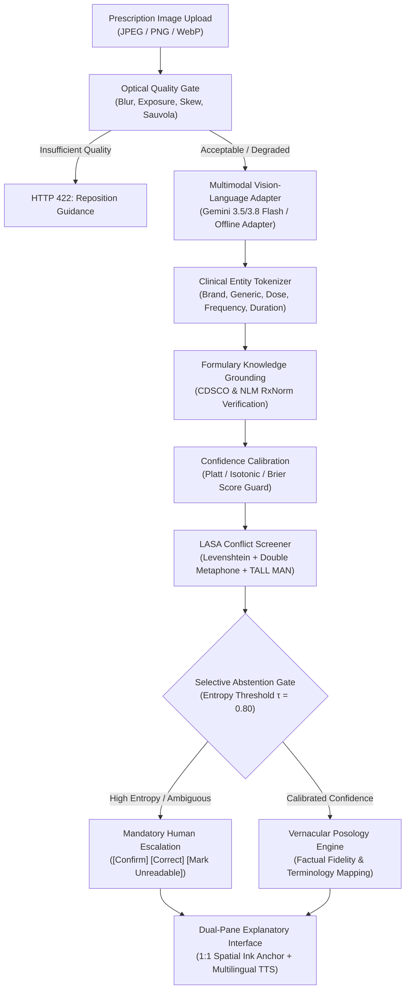

# DawaAI: Explainable Multimodal AI for Handwritten Prescription Understanding
### *Your Prescription, Made Clear.*

[](LICENSE)
[](#technology-stack)
[](#technology-stack)
[](#core-capabilities)
[](#testing--verification)
[](#testing--verification)
[](#multilingual-posology)

> **Academic Capstone Engineering Project**  
> Multimodal Medical Informatics & Vision-Language Artificial Intelligence  
> **Formal Title:** *Explainable Multimodal AI for Handwritten Prescription Understanding*  
> **Brand & Application:** **DawaAI** (*Your Prescription, Made Clear.*)

---

## 1. Executive Summary & Problem Solved

Illegible physician handwriting is a historic and persistent hazard in outpatient healthcare delivery. Under severe clinical time constraints, physicians routinely draft prescriptions using rapid cursive ligatures, non-standard abbreviations (*PC, AC, SOS, TDS, HS*), and irregular pen strokes.

### The Clinical Hazards
- **Adverse Drug Events (ADEs):** Dispensing errors arising from misread dosages or confusable drug names are among the leading preventable clinical errors worldwide.
- **The Generative AI Dilemma:** Conventional OCR engines (e.g., Tesseract) fail catastrophically on cursive scripts (>50% Word Error Rate). Conversely, commercial Vision-Language Models (VLMs) suffer from **uncalibrated overconfidence**: when faced with ambiguous strokes (e.g., `1.0 mg` vs `10 mg`), they fabricate plausible-sounding numbers rather than acknowledging uncertainty, risking lethal 10-fold overdoses.
- **Patient Posology Illiteracy:** Patients frequently struggle to comprehend Latin medical shorthand, leading to non-adherence or taking medications at incorrect meal intervals.

### The DawaAI Solution
**DawaAI** bridges the gap between raw doctor handwriting and vernacular patient understanding through an **evidence-grounded, uncertainty-calibrated multimodal pipeline**. DawaAI strictly preserves the original physical prescription as the primary ground truth, grounds every candidate medication against statutory pharmacopeias, abstains when handwriting is ambiguous, and generates clear, actionable dosage schedules in **English**, **Hindi (हिन्दी)**, and **Marathi (मराठी)**.

---

## 2. Core Capabilities

- **1:1 Spatial Ink Grounding:** The original physician prescription image is preserved byte-for-byte. Every extracted entity (medicine name, dosage, frequency, duration, route) links directly to its interactive spatial polygon on the physician's pad.
- **Multimodal Cursive Extraction:** Vision-language adapter architecture leveraging high-resolution visual tokens to transcribe cursive ligatures without fragile intermediate OCR steps.
- **Formulary Knowledge Grounding (RAG):** Candidate medications are strictly validated against authoritative reference databases:
  - **CDSCO (India):** Directorate General of Health Services approved drug formulations.
  - **NLM RxNorm (US NLM):** Normalized clinical medicine nomenclature and RxCUIs.
  - *Invariant:* Non-existent medicines are rejected; observed dosages are strictly immutable and never rewritten.
- **Uncertainty-Aware Selective Abstention:** The system measures predictive entropy and calibration error. If handwriting is illegible, smudged, or conflicting, the pipeline **deliberately abstains** and flags the script for human pharmacist verification rather than guessing.
- **Look-Alike / Sound-Alike (LASA) Conflict Guard:** Computes orthographic (Levenshtein) and phonetic (Double Metaphone) similarity against the ISMP 2024 confusable drug catalogue. Applies standardized **TALL MAN lettering** (e.g., `metFORMIN` vs `metRONIDAZOLE`) to prevent dispensing errors.
- **Multilingual Patient Posology:** Converts complex clinical shorthand into clear, empathetic posology schedules with visual morning/afternoon/night slots, meal relations, precautions, and browser-native voice narration in **English**, **Hindi (हिन्दी)**, and **Marathi (मराठी)**.
- **Human-in-the-Loop Clinical Verification:** Interactive clinician review workflow with three unambiguous actions: `[Confirm]`, `[Correct]`, and `[Mark Unreadable]` with complete audit logging.

---

## 3. System Architecture



---

## 4. Technology Stack

| Layer | Technologies | Role & Architectural Rationale |
| :--- | :--- | :--- |
| **Frontend Framework** | **React 19** + **TypeScript** (Strict) | High-performance, concurrent component architecture with strict compile-time type safety. |
| **Bundler & Build** | **Vite 8** + `@tailwindcss/vite` | Sub-second Hot Module Replacement (HMR) and optimized minified production bundle. |
| **Styling & Theme** | **Tailwind CSS v4** + Brand Kit | Sleek modern aesthetics: Plum (`#4A2E4D`), Rose (`#F472B6`), Soft Pink (`#FFD6DA`), Canvas (`#F8F2F6`), dark mode support. |
| **Visual Effects** | Custom HTML5 Canvas | 3D Silk Gradient Ribbon hero animation with interactive mouse responsiveness. |
| **Backend API** | **FastAPI** + **Python 3.12** + **Uvicorn** | High-throughput asynchronous ASGI microservice with automatic OpenAPI documentation. |
| **Data Contracts** | **Pydantic v2** | Strict bidirectional request/response validation with immutable audit seals. |
| **Image Processing** | **Pillow** + **NumPy** + **SciPy** | Deterministic optical validation: Laplacian blur, projection-profile deskewing, Sauvola binarization. |
| **AI / Multimodal** | **Google Gemini API** (`gemini-3.5-flash-lite` / `gemini-3.8-flash`) | Multimodal vision-language understanding of cursive handwriting ligatures. |
| **Reference Grounding** | **CDSCO** & **NLM RxNorm** Data Stores | Authoritative formulary verification and formulation consistency screening. |
| **Phonetic Engine** | **Double Metaphone** + **Levenshtein** | ISMP TALL MAN confusable drug name collision detection. |
| **Speech Synthesis** | Web Speech API | Client-side vernacular text-to-speech for accessible dosage schedules. |

---

## 5. Repository Structure

```text
genai-prescription-decoder/
├── index.html                   # HTML entry with DM Serif Display & Inter typography
├── package.json                 # Frontend dependencies & build scripts
├── tsconfig.json                # Strict TypeScript configuration
├── vite.config.ts               # Vite configuration with @ path aliases
├── backend/                     # FastAPI backend application
│   ├── app/
│   │   ├── main.py              # FastAPI app factory, CORS, exception handlers
│   │   ├── config.py            # Pydantic v2 settings & environment configuration
│   │   ├── api/v1/routes/       # /process, /analyze, /health, /multimodal, /validation, etc.
│   │   ├── models/              # Pydantic data schemas, enums, and error models
│   │   ├── services/            # Multimodal pipeline, mock pipeline, and file storage
│   │   ├── preprocessing/       # Optical quality validator, deskew, and Sauvola pipeline
│   │   ├── ocr/                 # Tesseract OCR baseline comparison engine
│   │   └── multimodal/          # Gemini vision adapters, parser, and prompt schemas
│   ├── tests/                   # Pytest test suite (608 passing unit & integration tests)
│   ├── requirements.txt         # Backend Python dependencies
│   └── run.py                   # Local development server runner (dynamic port binding)
├── ai/                          # Clinical safety & intelligence engines
│   ├── rag/                     # CDSCO & RxNorm formulary grounding engine
│   ├── confidence/              # Calibration metrics (ECE, MCE, Brier, Platt, Isotonic)
│   ├── abstention/              # Uncertainty-aware selective abstention policies
│   ├── lasa/                    # Look-Alike / Sound-Alike collision detector
│   └── explanation/             # Multilingual posology engine (EN, HI, MR)
├── data/                        # Sample data, ground-truth manifests, and reference sets
│   ├── manifests/               # Cryptographic SHA-256 dataset manifests
│   ├── reference/               # Curated CDSCO & RxNorm reference datasets
│   └── samples/                 # Standard calibration and CI prescription samples
├── docs/                        # Formal academic thesis reports & operational runbooks
│   ├── capstone-final-report.md # Comprehensive 14-Phase Capstone Thesis Report
│   ├── research-paper-draft.md  # Academic paper draft (IEEE/ACM style)
│   ├── architecture-dfd.md      # System Data Flow Diagrams (Level 0, 1, 2)
│   ├── DEPLOYMENT_RUNBOOK.md    # Production deployment runbook
│   ├── SECURITY_AND_PRIVACY.md  # Ephemeral storage and zero-PHI policy
│   └── API.md                   # Complete OpenAPI specification
├── eval/                        # Reproducible evaluation scripts, tables, and plots
├── src/                         # React 19 frontend source code
│   ├── main.tsx                 # Application DOM mount
│   ├── App.tsx                  # Root application router and layout shell
│   ├── styles/globals.css       # Tailwind CSS v4 design system tokens and glass panels
│   ├── components/              # UI components (Hero, Navbar, Workspace, Safety, Posology)
│   ├── services/api/            # HTTP and mock prescription API client adapters
│   └── types/                   # TypeScript interfaces for API, safety, and posology
└── Dockerfile                   # Production container definition
```

---

## 6. Quickstart & Local Setup

### Prerequisites
- **Node.js**: `v20.x` or later (tested on v24)
- **Python**: `3.10` or later (tested on Python 3.12)
- **Google Gemini API Key**: Obtainable from [Google AI Studio](https://aistudio.google.com/)

---

### Step 1: Clone & Configure Environment

```bash
git clone https://github.com/SwayamMandhani06/genai-prescription-decoder.git
cd genai-prescription-decoder

# Copy the example environment file
cp .env.example .env
```

Edit `.env` with your API credentials and preferred configuration:
```ini
# Google Gemini API Key for live cursive handwriting understanding
GEMINI_API_KEY=AIzaSy...

# Multimodal model selection
MULTIMODAL_MODEL_ID=gemini-3.5-flash-lite

# Pipeline mode (set to false for live Gemini inference)
USE_MOCK_PIPELINE=false
VITE_USE_MOCK_API=false

# Port configuration
PORT=8001
VITE_API_BASE_URL=http://localhost:8001
```

---

### Step 2: Backend Setup (FastAPI)

```bash
# Recommended: Create and activate a Python virtual environment
python -m venv venv
# On Windows:
.\venv\Scripts\activate
# On Linux/macOS:
# source venv/bin/activate

# Install dependencies
pip install -r backend/requirements.txt

# Start the FastAPI backend server
python backend/run.py
```
*The backend will start at `http://localhost:8001` (interactive Swagger docs at `http://localhost:8001/docs`).*

---

### Step 3: Frontend Setup (React + Vite)

In a new terminal window:
```bash
# Install Node dependencies
npm install

# Start the Vite development server
npm run dev
```
*The frontend application will be live at `http://localhost:5173`.*

---

### Alternative: Run with Docker Compose

```bash
docker compose up --build
```
*Access the unified application at `http://localhost:8000`.*

---

## 7. API Reference

| Endpoint | Method | Description |
| :--- | :---: | :--- |
| `/api/v1/prescriptions/process` | `POST` | Canonical prescription processing endpoint (accepts `multipart/form-data` image or sample ID). |
| `/api/v1/prescriptions/analyze` | `POST` | Preserved alias for seamless backward compatibility. |
| `/health` | `GET` | Root load-balancer health probe with runtime dependency status. |
| `/api/v1/health` | `GET` | Versioned API health and active pipeline diagnostic report. |
| `/api/v1/verification/{id}/fields/{f}/confirm` | `POST` | Clinician confirmation of an extracted field in the audit trail. |
| `/api/v1/verification/{id}/fields/{f}/correct` | `POST` | Clinician correction of an extracted field (preserves original extraction). |
| `/api/v1/verification/{id}/fields/{f}/unreadable` | `POST` | Explicit unreadable stroke marking without guessing. |
| `/api/v1/multimodal/extract` | `POST` | Dedicated vision-language extraction endpoint. |
| `/api/v1/validation/medicine` | `POST` | RAG CDSCO and RxNorm formulary grounding verification. |
| `/api/v1/lasa/detect` | `POST` | Orthographic and phonetic Look-Alike / Sound-Alike screening. |
| `/api/v1/explanation/generate` | `POST` | Multilingual patient posology generation (`en`, `hi`, `mr`). |

---

## 8. Testing & Verification

The repository enforces strict quality gates across both frontend and backend architectures:

```bash
# 1. Run full backend Pytest suite (608 passing unit and integration tests)
python -m pytest backend/tests -v

# 2. Run frontend Vitest suite (123 passing tests across 14 UI states)
npm test

# 3. Static TypeScript compilation check (0 errors)
npx tsc --noEmit

# 4. Production bundle build check
npm run build
```

---

## 9. Production Deployment Guide

### Frontend Deployment (Vercel)
1. Import the repository `SwayamMandhani06/genai-prescription-decoder` on [Vercel](https://vercel.com).
2. Set the **Framework Preset** to **Vite**.
3. Configure the following **Environment Variables** in the Vercel dashboard:
   - `VITE_API_BASE_URL`: The URL of your deployed backend (e.g., `https://dawaai-api.onrender.com`).
   - `VITE_USE_MOCK_API`: `false`
4. Deploy. Vercel automatically runs `npm run build` and serves the optimized single-page app via edge CDN.

### Backend Deployment (Render / Cloud PaaS)
1. Create a new **Web Service** on [Render](https://render.com) connected to this repository.
2. Select **Docker** environment (or **Python 3** with `pip install -r backend/requirements.txt`).
3. Set the **Start Command**:
   ```bash
   uvicorn backend.app.main:app --host 0.0.0.0 --port $PORT
   ```
4. Configure the following **Environment Variables** on Render:
   - `GEMINI_API_KEY`: Your Google AI Studio API key.
   - `MULTIMODAL_MODEL_ID`: `gemini-3.5-flash-lite` or `gemini-3.8-flash`.
   - `USE_MOCK_PIPELINE`: `false`
   - `CORS_ORIGINS`: Your Vercel frontend domain (e.g., `https://dawaai.vercel.app`).
   - `PORT`: Automatically assigned by Render.

---

## 10. Clinical Safety & Statutory Notice

> [!CAUTION]
> **STATUTORY REGULATORY NOTICE**  
> DawaAI is an **assistive research and educational technology demonstration** in multimodal artificial intelligence and healthcare informatics.
>
> - **Under Section 42 of the Pharmacy Act (1948), dispensing prescription medications without the direct supervision of a Registered Pharmacist is a statutory offence.**
> - **The physical handwritten prescription signed by a licensed Registered Medical Practitioner (RMP) remains the sole authoritative, legally binding document.**
> - DawaAI is designed strictly as an assistive second-reader and posology explanation tool; it **must not** be used as an autonomous dispensing authority or diagnostic medical device.
> - Patients must never start, stop, or modify prescribed medication regimens without direct consultation with a qualified physician or licensed clinical pharmacist.

---

## 11. Documentation & Research Deliverables

- **[Capstone Final Report](docs/capstone-final-report.md):** Comprehensive thesis covering mathematical foundations, error taxonomy, and evaluation.
- **[Research Paper Draft](docs/research-paper-draft.md):** Academic manuscript prepared with IEEE/ACM styling.
- **[Architecture & Data Flow Diagrams](docs/architecture-dfd.md):** Complete Level 0, Level 1, and Level 2 Data Flow Diagrams.
- **[Deployment Runbook](docs/DEPLOYMENT_RUNBOOK.md):** Step-by-step production operations and incident response guide.
- **[Security & Privacy Policy](docs/SECURITY_AND_PRIVACY.md):** Ephemeral memory storage, zero-PHI persistence, and DevSecOps controls.
- **[REST API Specification](docs/API.md):** Full OpenAPI documentation with error contracts.

---

## 12. License & Authors

Distributed under the **MIT Academic License**. See [`LICENSE`](LICENSE) for terms.

- **Author:** Swayam Mandhani
- **Project Identity:** DawaAI (*Your Prescription, Made Clear.*)
- **Research Domains:** Multimodal Medical Vision-Language Models, Clinical NLP, Uncertainty Quantification, Vernacular Health Equity.
