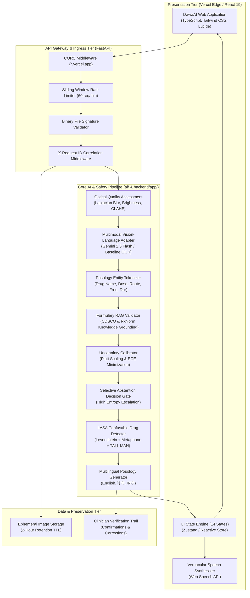

# DawaAI System Architecture & Engineering Design

**Formal Project Title:** DawaAI: An Explainable Multimodal AI System for Handwritten Prescription Understanding and Safety Validation  
**Tagline:** *Your Prescription, Made Clear.*  
**Architecture Classification:** Decoupled Multimodal Vision-Language AI with Grounded Pharmacopeia Validation

---

## 1. System Context & Top-Level Data Flow

---

## 2. Core Architectural Pillars

### 2.1 Spatial Ink Tethering
The application preserves the original handwritten document as legal ground truth. Each extracted posology entity contains normalized bounding polygon coordinates `[ymin, xmin, ymax, xmax]` that visually anchor to the original document scan in the dual-pane viewer.

### 2.2 Calibrated Selective Abstention
Unlike generic conversational AI that hallucinates plausible medication names when cursive strokes are illegible, DawaAI measures token uncertainty and predictive entropy. When stroke clarity is below threshold, the system triggers `ABSTAINED` or `NEEDS_VERIFICATION` status, preventing dangerous clinical misinterpretations.

### 2.3 Pharmacopeia RAG Grounding
Extracted text tokens are validated against official medical drug registries:
- **CDSCO National Formulary of India:** Matches Indian domestic brand names, generic formulations, and scheduled drug classifications.
- **US NLM RxNorm:** Matches clinical drug components, RxCUIs, and international generic identifiers.

### 2.4 ISMP TALL MAN LASA Detection
Look-Alike Sound-Alike errors are mitigated by calculating composite orthographic (Levenshtein) and phonetic (Double Metaphone) distances. Confusable medications trigger proactive visual warnings with standardized ISMP TALL MAN typography (e.g. `hydrALAZINE` vs `hydrOXYzine`).

### 2.5 Multilingual Posology Translation
Instructions are translated into clear, vernacular schedules in **English, Hindi (हिन्दी), and Marathi (मराठी)** with morning, afternoon, evening, and night timing slots.
