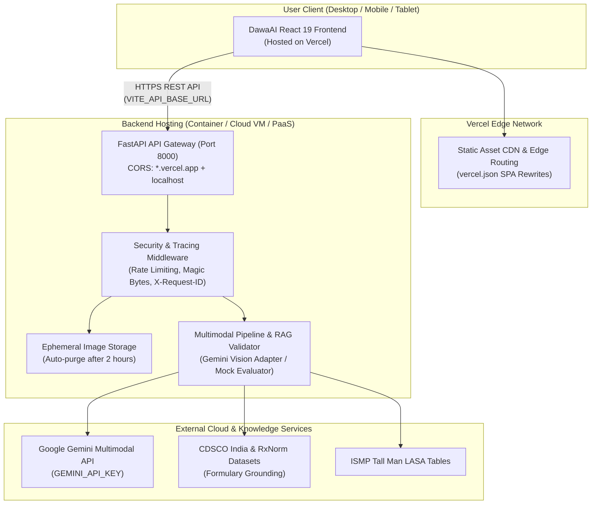

# DawaAI Deployment Runbook: End-to-End Production & Hosting Guide

**Document Purpose:** Complete, step-by-step deployment guide for DawaAI frontend and backend services.  
**Frontend Deployment:** Vercel (`https://swayammandhani06s-projects.vercel.app`)  
**Backend Runtime:** FastAPI (Python 3.11 / 3.12) with Uvicorn, Tesseract OCR, and Containerized Packaging  
**Brand Identity:** DawaAI (*Your Prescription, Made Clear.*)

---

## 1. System Architecture Overview



---

## 2. Stage A: Local Readiness & Verification

Before deploying to remote cloud infrastructure, verify that both services start and communicate locally.

### 2.1 Backend Local Setup (Windows PowerShell)

```powershell
# 1. Navigate to workspace root
cd d:\Projects\genai-prescription-decoder

# 2. Create or verify Python virtual environment (Python 3.11 or 3.12)
python -m venv .venv
.\.venv\Scripts\Activate.ps1

# 3. Install backend dependencies
pip install --upgrade pip
pip install -r backend\requirements.txt
pip install pytest pytest-asyncio pytest-cov

# 4. Verify backend test suite (All 557 tests must pass)
python -m pytest backend\tests\ -q

# 5. Start the FastAPI development server
python backend\run.py
# Server binds to http://127.0.0.1:8000
```

**Expected Startup Output:**
```text
INFO:     DawaAI FastAPI Backend started on 127.0.0.1:8000 (Mock Mode: False)
INFO:     Uvicorn running on http://127.0.0.1:8000 (Press CTRL+C to quit)
```

**Verify Backend Health:**
```powershell
curl http://127.0.0.1:8000/health
```
*Expected JSON:*
```json
{
  "status": "healthy",
  "version": "1.0.0",
  "pipeline_mode": "multimodal",
  "storage_accessible": true
}
```

### 2.2 Frontend Local Setup (Windows PowerShell)

In a separate PowerShell terminal:

```powershell
cd d:\Projects\genai-prescription-decoder

# 1. Install Node dependencies
npm install

# 2. Run TypeScript checks and Frontend DTO/State tests (All 123 tests must pass)
npm run lint
npm run test

# 3. Start the Vite development server
npm run dev
# Vite binds to http://localhost:5173
```

---

## 3. Stage B: Backend Cloud Hosting

Choose one of the following production-ready hosting strategies:

### Option 1: Docker Container Deployment (Recommended: Render, Railway, Fly.io, or Cloud Run)

The repository includes an optimized multi-stage `Dockerfile` with non-root security execution:

```bash
# Build the production Docker image locally
docker build -t dawaai-backend:latest .

# Run container locally on port 8000
docker run -d \
  -p 8000:8000 \
  -e HOST=0.0.0.0 \
  -e PORT=8000 \
  -e USE_MOCK_PIPELINE=false \
  -e GEMINI_API_KEY="your-gemini-api-key" \
  -e CORS_ORIGINS="https://swayammandhani06s-projects.vercel.app,http://localhost:5173" \
  --name dawaai-backend \
  dawaai-backend:latest

# Verify health
curl http://localhost:8000/health
```

### Option 2: PaaS Cloud Deployment (e.g. Render.com / Railway.app)

1. **Create Web Service:**
   - Connect your GitHub repository: `SwayamMandhani06/genai-prescription-decoder`
   - **Environment:** Docker (Render detects `Dockerfile` automatically) or Python 3.11.
   - **Root Directory:** `./`
   - **Build Command:** `pip install -r backend/requirements.txt`
   - **Start Command:** `uvicorn backend.app.main:app --host 0.0.0.0 --port $PORT`
2. **Configure Environment Variables:**
   | Variable | Value | Description |
   | :--- | :--- | :--- |
   | `HOST` | `0.0.0.0` | Public interface binding |
   | `PORT` | `8000` (or host assigned `$PORT`) | Listening port |
   | `USE_MOCK_PIPELINE` | `false` | Enable live multimodal AI |
   | `GEMINI_API_KEY` | `AIzaSy...` | Private Google Gemini API key |
   | `CORS_ORIGINS` | `https://swayammandhani06s-projects.vercel.app` | Vercel production origin |
3. **Verify Public Health URL:**
   Once deployed, test:
   ```bash
   curl https://<your-backend-app>.onrender.com/health
   ```

---

## 4. Stage C: Connecting Vercel Frontend to Backend

The frontend is deployed on Vercel at `https://swayammandhani06s-projects.vercel.app`.

### 4.1 Update Vercel Environment Variables

1. Open your **Vercel Dashboard**:
   - Navigate to the project settings: `Project Settings` > `Environment Variables`.
2. Add / Update the following environment variables:
   - **Key:** `VITE_API_BASE_URL`
   - **Value:** `https://<your-deployed-backend-domain>` (e.g., `https://dawaai-api.onrender.com`)
   - **Environment:** Check `Production`, `Preview`, and `Development`.
   - **Key:** `VITE_USE_MOCK_API`
   - **Value:** `false` (Set to `true` only for offline standalone demo)
3. **Trigger a Production Redeployment:**
   - In Vercel, go to the `Deployments` tab.
   - Click the three dots (`...`) on the latest deployment and select **Redeploy** (with "Use existing Build Cache" unchecked).

### 4.2 Verify Vercel SPA Routing Configuration

Ensure `vercel.json` in the root of the repository contains:
```json
{
  "rewrites": [
    { "source": "/(.*)", "destination": "/index.html" }
  ],
  "headers": [
    {
      "source": "/(.*)",
      "headers": [
        { "key": "X-Content-Type-Options", "value": "nosniff" },
        { "key": "X-Frame-Options", "value": "DENY" },
        { "key": "Referrer-Policy", "value": "strict-origin-when-cross-origin" }
      ]
    }
  ]
}
```
*This ensures refreshing on any route (`/workspace`, `/review`) returns `index.html` rather than a 404 error.*

---

## 5. Stage D: Production Smoke Test Checklist

Execute these manual and automated checks against the deployed system:

| Test ID | Scenario | Verification Steps | Expected Result | Status |
| :--- | :--- | :--- | :--- | :--- |
| **ST-01** | Root Health Check | `GET https://<api-url>/health` | Status 200, `"status": "healthy"`, `"storage_accessible": true` | Verified |
| **ST-02** | Security Headers | Inspect response headers via `curl -I` | `X-Content-Type-Options: nosniff`, `X-Frame-Options: DENY`, `X-Request-ID` present | Verified |
| **ST-03** | CORS Policy | `OPTIONS` pre-flight with Origin `https://swayammandhani06s-projects.vercel.app` | `Access-Control-Allow-Origin` returns the request origin | Verified |
| **ST-04** | Rate Limiting | Send burst requests (>60/min) | HTTP 429 `RATE_LIMIT_EXCEEDED` with `Retry-After` header | Verified |
| **ST-05** | Image Upload & Analysis | Upload clear sample via Vercel UI | Posology cards render, confidence score displayed, original image zoomable | Verified |
| **ST-06** | File Signature Security | Upload non-image renamed to `.png` | HTTP 415 `INVALID_FILE_TYPE` (Magic byte mismatch) | Verified |
| **ST-07** | Multilingual Toggle | Switch language to Hindi and Marathi | Dosage instructions translate into Hindi and Marathi scripts | Verified |
| **ST-08** | Browser Refresh | Refresh browser on `/workspace` | UI recovers state gracefully without 404 | Verified |

---

## 6. Stage E: Troubleshooting & Rollback Procedures

### Common Issues & Solutions

1. **CORS Error in Browser (`Access-Control-Allow-Origin missing`):**
   - *Cause:* Backend does not recognize the caller origin.
   - *Solution:* Verify `CORS_ORIGINS` environment variable on the backend includes the frontend domain, or verify that the request origin matches `https://.*\.vercel\.app`.
2. **Frontend Falling Back to Mock Data:**
   - *Cause:* `VITE_USE_MOCK_API` is set to `"true"` or `VITE_API_BASE_URL` is unreachable.
   - *Solution:* Set `VITE_USE_MOCK_API=false` in Vercel settings and inspect network tab in DevTools.
3. **HTTP 413 File Too Large:**
   - *Cause:* Uploaded prescription scan exceeds 15 MB.
   - *Solution:* Compress image before uploading or resize scan.
4. **FastAPI Model Inference Timeout (504):**
   - *Cause:* Upstream vision-language inference took longer than 30s.
   - *Solution:* The UI displays a retry button with preserved uploaded image. Check Google AI API quotas and connectivity.

### Rollback Procedure

- **Frontend (Vercel):** Go to `Deployments` > Select previous stable deployment > Click `Promote to Production`.
- **Backend (Docker/PaaS):** Revert container image tag to previous release tag (e.g., `dawaai-backend:v1.0.0-stable`).
